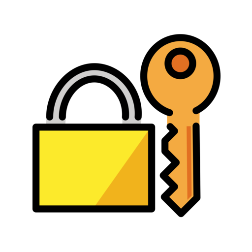

<!-- {=projectReadme} -->

<div align="center">
  <a href="https://ifiokjr.github.io/monosecret/">
    
  </a>

<h1>Monosecret</h1>

<p><strong>Declare secrets once. Store them anywhere.</strong></p>

<p>
    A declarative secrets manager for development workflows. Commit the secrets your app
    needs in <code>monosecret.toml</code>; keep the actual values in keyring, 1Password,
    Vault, AWS, GCP, Bitwarden, dotenv, env vars, or another provider.
  </p>

<p>
    <a href="https://github.com/ifiokjr/monosecret/actions/workflows/ci.yml"></a>
    <a href="https://codecov.io/gh/ifiokjr/monosecret"></a>
  </p>

<p>
    <a href="https://ifiokjr.github.io/monosecret/"><strong>Documentation</strong></a>
    |
    <a href="https://ifiokjr.github.io/monosecret/quick-start/">Quick Start</a>
    |
    <a href="https://crates.io/crates/monosecret">Crates.io</a>
    |
    <a href="https://docs.rs/monosecret">docs.rs</a>
    |
    <a href="https://discord.gg/naMgvexb6q">Discord</a>
  </p>
</div>

---

## Why Monosecret?

Secrets usually drift into `.env` files, Slack messages, per-machine notes, and CI
settings nobody can audit. Monosecret separates **declaration** from **storage**:

- **Declare** required secrets in versioned `monosecret.toml` files.
- **Store** values in the provider that fits each environment.
- **Run** apps with secrets injected only at runtime.
- **Validate** onboarding, CI, and deploy requirements before they fail later.

## Quick start

```shell-session
$ monosecret init --from .env
$ monosecret config init
$ monosecret check
$ monosecret run -- npm start
```

```toml
[project]
name = "my-app"
revision = "1.0"

[profiles.default]
DATABASE_URL = { description = "PostgreSQL connection string", required = true }
REDIS_URL = { description = "Redis cache", required = false }

[profiles.production]
DATABASE_URL = { providers = ["vault", "keyring", "env"] }
```

## Features

- **Declarative configuration** - define secret names, descriptions, defaults,
  generation rules, groups, and profile-specific overrides.
- **41 storage backends** - keyring, dotenv, environment variables, 1Password,
  Bitwarden, Vault/OpenBao, AWS Secrets Manager and Parameter Store, Google Cloud
  Secret Manager, Azure Key Vault, Kubernetes, SOPS, age, Doppler, Infisical,
  and more. See the [provider reference](https://ifiokjr.github.io/monosecret/reference/providers/).
- **CI-friendly loading** - `monosecret env --shell github --profile ci` appends
  masked values to `$GITHUB_ENV`.
- **Type-safe Rust SDK** - generate strongly typed Rust structs from
  `monosecret.toml` at compile time.
- **SDKs for ten languages** - TypeScript, Python, PHP, Ruby, Go, Dart, Swift,
  C#, and Haskell bindings sit on the same Rust core and pass one shared
  conformance suite.
- **Auditable access** - require human-readable reasons and keep local access logs
  without writing secret values.

## Install

```shell-session
$ npm install --global @monosecret/cli
```

See the [installation guide](https://ifiokjr.github.io/monosecret/quick-start/#installation)
for Nix, devenv, and other options.

## Repository layout

- `crates/` - Rust crates: the `monosecret` library and CLI, the derive macro,
  the FFI layer, and the RPC wire protocol.
- `npm/` - npm packages, including the TypeScript client and CLI wrapper packages.
- Language SDKs: `dart/`, `python/`, `php/`, `ruby/`, `go/`, `swift/`, `dotnet/`,
  and `haskell/`.
- `conformance/` - the cross-SDK conformance suite and its IPC runner.
- `schema/` - JSON Schemas for the resolution report and wire protocols.
- `docs/` - the documentation site.
- `examples/` - examples across supported ecosystems.

## Building from source

```shell-session
$ cargo build --release
```

This builds the CLI crate only. Building the full workspace (FFI, npm, PHP,
Python, and example crates) additionally requires the `php`, `python`, and
`node` toolchains — devenv provides all of them — and is selected explicitly
with `cargo build --workspace`.

## Learn more

- [Configuration reference](https://ifiokjr.github.io/monosecret/reference/configuration/)
- [Provider reference](https://ifiokjr.github.io/monosecret/reference/providers/)
- [CI/CD setup](https://ifiokjr.github.io/monosecret/guides/ci/)
- [Rust SDK](https://ifiokjr.github.io/monosecret/sdk/rust/)

<!-- {/projectReadme} -->
